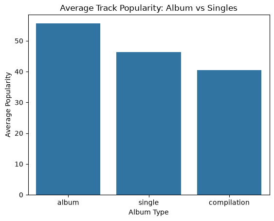

# SPOTIFY_CSV_FILE DATA ANALYSIS

## Executive_summary

- **Project_Aim**:To Perform an analysis on a spotify perfomance metrics csv file to gain insight and unserstanding on the data in the file.

- **Project_Scope**: Currently One simple Data Analysis with and accompanying graph to demonstarate my understanding on data analystics.

- **Analytics and Tech Stack**: Using `Python` Libraries such as `pandas`, `seaborn`and `matplotlib`.

**If You Do Find Time Please Go Through This(these) File(s).**
1. [spotify_analysis](Data\spotify_data clean.csv)

**It is A jupiter Notebook to show the nuts and bolts behind acquring the insight**

## Project_context

I wanted To perform a simple analysis  to answer the question "**ALBUM VS SINGLES**" which one gains more popularity.

 Historically and commercially, certain acts (such as Pitbull, Flo Rida, or Jason Derulo) are characterized as "singles artists" who drive massive individual hit records rather than traditional front-to-back album sales.

 This Project Analyzes a csv file that contains raw data :
 -  [Spotify_csv](../Data/spotify_data_clean.csv)

 ## Tech_Stack
 **Language**: Pyhton

 **Libraries**: `pandas` ,`seaborn` , `matplotlib`

 ## Abilities Demonstrated
 - **Data Extraction and Understanding**: I used the pandas Library to create a datagram of the csv file.then i ran lines to get the general idea of the datagram I am Dealing with. Functions line`.shape`,`.describe`,`.info`.
where i basically gained an understanding on how the data looks like and if there is any cleaning needed before analysis.

- **Data_Cleaning**: In this stage i simple had to consult the `.info()` Function where i discovered that there are indexes missing `Artist_names` so i removed those. In the  `Date-released` we only needed the year values incase i choose to perfom a Year-sensitive Analysis, And alos i needed them is Integers Rather Than Strings.

  I also Had to clean The Text Colomns In case There Were any accidental Whitespaces.

- **Data-Analysis**: In my analysis (Initial/0.1) I wanted To answer The question Albums vs Singles? Which are more Popular
  so i created a new Entry Grouping Track_Types and Popularity and i found the Mean value Between Different Track Types.
   I then Used The matplotlib and Seaborn To plot and Visualise My Findings.

   
   

   That Concluded My First Analysis Ending and internal debate. 

   - Artists Need To create More Albums that singles as Albums have more Popularity Amongst The Listening Audience.

  

